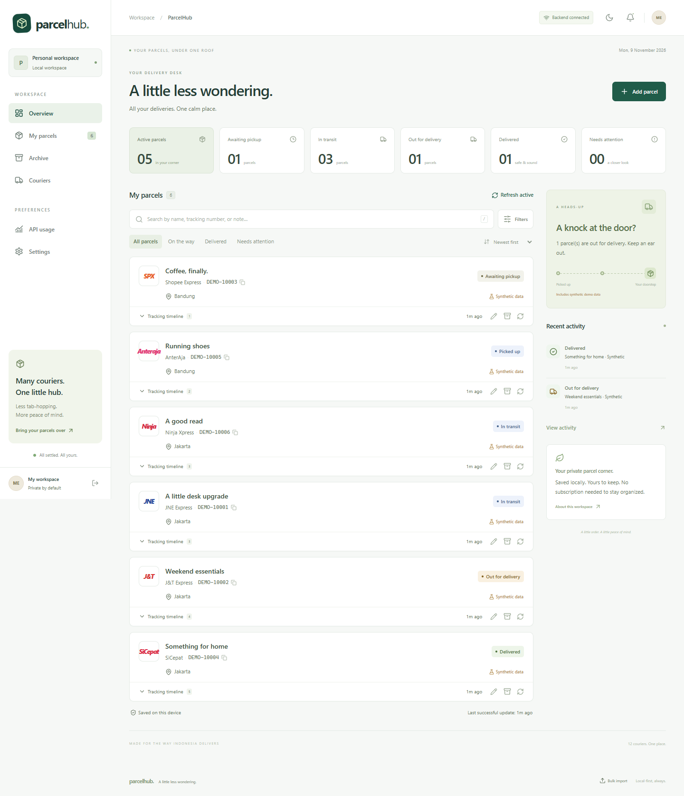

# ParcelHub

**All your deliveries. One calm place.** A self-hosted parcel dashboard for Indonesian couriers, with SQLite persistence, offline editing, and explicit tracking provenance.



## Run locally

Install **Node.js 24.10 or later** (Node 24 LTS recommended) with npm. Node's built-in SQLite avoids native database compilation.

```sh
npm ci
cp .env.example .env
npm run dev
```

On PowerShell, use `Copy-Item .env.example .env` instead of `cp`. Open **http://127.0.0.1:5173**. Vite proxies the backend on port 3001. Both processes bind to localhost by default. Use a consistent hostname; localhost and 127.0.0.1 have separate browser caches.

Windows convenience launcher: `powershell -ExecutionPolicy Bypass -File .\Start-ParcelHub.ps1` builds and runs the production app. Add `-Development` for Vite. If this machine has Node but no npm, the launcher downloads a pinned, workspace-local npm from the official registry. It does not change system installation or execution-policy settings.

For production, including PWA/offline shell support:

```sh
npm run build
npm start
```

Open **http://127.0.0.1:3001**. The backend serves the built React application. SQLite is stored in `data/parcelhub.sqlite`; it survives process restarts and builds. Stop with Ctrl+C. The PWA shell is enabled in production builds, not Vite development.

The dashboard starts empty. Add a real number with automatic/manual tracking, or choose **Explore with demo parcels** to create clearly labeled synthetic examples. No live subscription is needed to save, search, edit, archive, import, or export parcels. Mock parcels advance through deterministic synthetic stages every minute and update when refreshed. They are never a fallback for real parcels.

## Features

- Twelve-courier registry; explicit active/configured/manual/unverified capability display.
- Save once, copy numbers, parcel details, full original event descriptions, timestamps with timezones, deduplicated history, notes, tags, store, and order date.
- Search names/numbers/notes; filter status, courier, tags, added date and changed date; sort, archive, restore, and bulk duplicate preview.
- Server-side Klik Resi SDK adapter, RajaOngkir AWB adapter, restricted Biteship tracking-ID adapter, deterministic mock provider, and verified manual links.
- Four-hour persistent scheduling, one-hour out-for-delivery priority, terminal/archive polling stop, capped backoff, authentication pauses, rate-limit handling, provider circuit breakers, serialized requests, and in-flight deduplication.
- Atomic request/cost reservations, global and provider caps, opt-in fallback, API usage page. Real API calls start **disabled**. Default monthly estimated cap is **Rp50,000**.
- IndexedDB snapshot and explicit mutation queue; offline creation/editing, replay with stable IDs, and visible conflicts. SQLite remains authoritative when reachable.
- Installable PWA with PNG/maskable icons, offline shell, update prompt, responsive mobile navigation, light/dark/system appearance, English/Bahasa Indonesia navigation and status labels.
- Persisted transition identifiers and browser notifications while open, controlled by explicit permission/subscriptions.
- JSON merge import/export and validated SQLite backup/restore. Restore downloads a prior snapshot for undo.
- Validation, same-origin mutation checks, localhost Host allowlist, CSP/security headers, rate limits, optional token sessions, and mandatory authentication for non-loopback bindings.

## Enable real tracking

1. Review [provider comparison](docs/provider-comparison.md) and confirm account access, current terms, courier support, and pricing with the provider.
2. Put credentials in the **backend `.env`**, never in a `VITE_` variable:

```dotenv
KLIKRESI_API_KEY=your-server-side-key
RAJAONGKIR_API_KEY=
RAJAONGKIR_CARRIERS=jne,sicepat
BITESHIP_API_KEY=
```

3. Restart the backend. In **Settings → API providers**, enable the provider, set priority, price estimate, and request caps. Click **Test connection**. Klik Resi tests account authentication; other adapters report configuration until actual tracking succeeds.
4. In **Settings → Request budgets**, enable real API calls and save settings. Fallback remains disabled unless explicitly enabled.
5. Refresh a saved **Automatic** parcel. The source, success timestamp, and errors appear on its card/details. ID Express through Klik Resi may need a recipient phone number; RajaOngkir JNE requires the final five phone digits. Supply these in **Edit parcel → More details**. This app never bypasses verification.
6. For Biteship, enter the tracking ID produced by your Biteship order in **More details → Biteship tracking ID**. The AWB alone cannot call the documented endpoint.

Authentication failures persistently pause the provider. Change `.env`, restart, then use **Reset circuit / auth pause**. No API keys are editable or retrievable through browser endpoints. Secrets do not enter SQLite or frontend builds.

## Data and offline behavior

Use **Settings → Your data** for exports and backups. JSON imports validate every record first, merge only new parcels, and skip existing IDs or courier/number duplicates. JSON imports do not replace settings. SQLite restore validates integrity, schema version, and records, then restores canonical data in one transaction. It never installs SQL, triggers, or views from an uploaded file. Backup uploads are limited to 20 MB.

Before a restore replaces records, the server also saves the previous database under `DATA_DIR/backups/`, independently of the browser's undo download. Mutations and the scheduler pause during restoration.

The browser retains saved parcels and queued edits in IndexedDB. The production service worker caches only application assets, not API responses. Pending edits overlay the last snapshot and survive refreshes. On reconnection, the queue replays before fetching authoritative data. A version mismatch pauses that parcel's queue; **Review changes** lets you inspect/export your edit, explicitly apply your fields to the current version, or discard the edit. Unsynced changes block import/restore in this browser. Keep the browser profile until pending edits have synchronized or been exported.

Offline caching is per device/browser origin, and can contain personal data. Sign-out invalidates the session cookie but intentionally retains the local offline cache; clear site data on a shared device. Browser storage can be evicted; keep SQLite/JSON backups. The server and browser must be reachable again for provider refreshes. Installing a PWA does not create an always-running server or a push service.

## Docker Compose

```sh
# Set PARCELHUB_AUTH_TOKEN to a random value of at least 24 characters in .env first.
docker compose up --build -d
docker compose ps
docker compose logs -f parcelhub
docker compose down
```

Open http://127.0.0.1:3001 and sign in with that token. The container runs as a non-root user, migrates automatically, uses a named persistent volume, and has an HTTP health check. `docker compose down` retains the volume. `docker compose down -v` deletes it: do not use that command unless intentionally removing all data.

For LAN/Internet use, see [deployment](docs/deployment.md). Authentication is mandatory whenever HOST is not loopback. Use HTTPS for remote access/PWA installation; keep shipping data private.

## Checks

```sh
npm run typecheck
npm run lint
npm test
npm run build
npm run test:e2e
npm audit --omit=dev
```

Playwright defaults to installed Microsoft Edge. Set `PLAYWRIGHT_CHANNEL=chrome` for Chrome, or install Edge with `npx playwright install msedge`. The tests start an isolated production backend, actually restart its process, exercise SQLite persistence and synthetic events, archive/restore, offline shell/edit/create/sync, duplicate previews, search, mobile layout, themes, and Bahasa. No real parcel/API credentials are used. See [validation](docs/validation.md) for the results observed in the delivery environment.

## Structure

```text
apps/web/                  React + Vite + Tailwind, TanStack Query, PWA
apps/server/src/
  modules/                 Parcel CRUD, import/export and backup/restore
  persistence/             Drizzle schema/proxy reads, SQLite and migrations
  providers/               Interface, error categories, real and mock adapters
  tracking/                Provider selection, budgets, refreshes and transitions
  scheduler/               Durable due-time polling and recovery
packages/shared/src/       Strict domain types, Zod validation and normalization
tests/                     Vitest, React Testing Library and Playwright
docs/                      Architecture, providers, deployment and validation
```

## Current limits

- No real API credentials were supplied; contract/fixture tests are separate from live verification. Provider-specific ambiguous statuses remain UNKNOWN. Courier availability can change.
- Some official tracking URLs could not be verified and are intentionally absent. Copy the saved number and consult the courier/marketplace directly. Links open a tracking page; no automatic prefilling is claimed.
- Main navigation, forms, and status labels support Bahasa; some advanced administrative explanations remain English.
- Notifications work while the app is open. There is no Web Push service, mobile background polling, or guaranteed delivery when all devices are closed/offline.
- This is a single-workspace application. The access token protects the whole workspace; there are no multiuser roles. Offline queues are per browser. Only one backend process may own a data directory.
- Provider request concurrency is one per provider; no distributed scheduler. Backups and SQLite itself are not encrypted at rest: use OS disk encryption and protected filesystem permissions.

Next: configure a provider account, verify one real shipment per enabled courier, and adjust request prices and quotas to your account. For broader deployment, add TLS and an always-running host.
